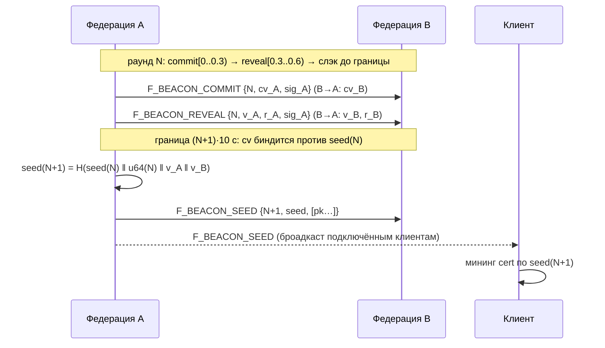
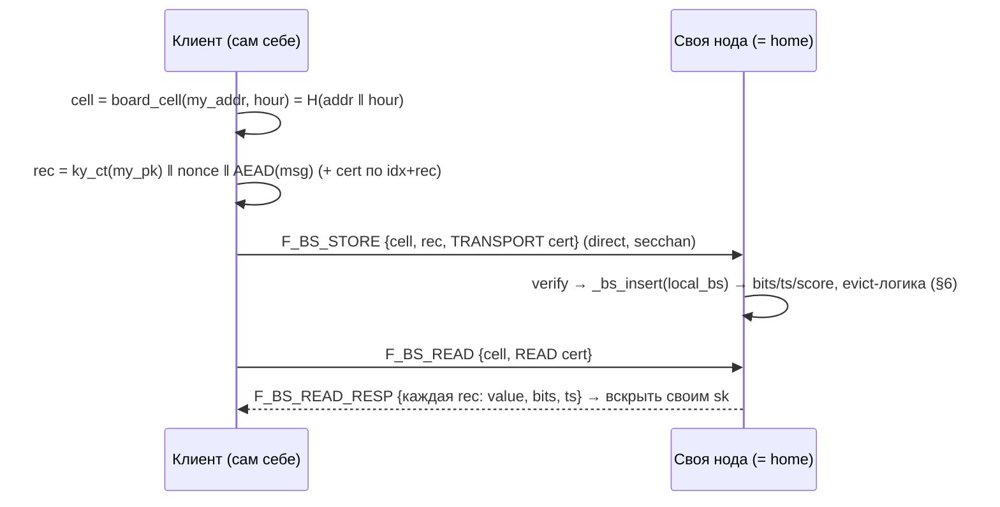
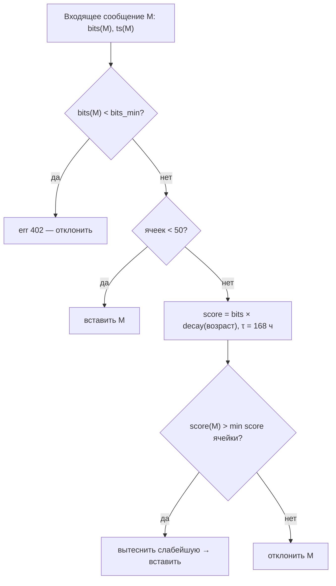

# jproto — документация текущего состояния

> Реализация против оригинальной схемы
> [justnyan1109/jproto (README)](https://github.com/justnyan1109/jproto) —
> сравнение по каждому разделу.

P2P + федеративный постквантовый мессенджер — реализация схемы
[justnyan1109/jproto](https://github.com/justnyan1109/jproto). Документ повторяет
структуру оригинального README: для каждого раздела — как работает сейчас и
таблица сравнения. Обозначения: ✅ соответствует оригиналу, ⚠️ отклонение/упрощение,
🧩 протокол/нода готовы, клиентская часть не сделана, ➕ новшество сверх оригинала,
❌ не реализовано.

Реализация: `python/` — эталонная нода и клиент (wire-эталон), `src/` + `include/` —
C-эталон тех же примитивов, `docker/compose.yml` — федерация из 3 нод.
Детали форматов: [wire.md](wire.md), [protocol.md](protocol.md); запуск: [RUN.md](../RUN.md).

---

## Термины

| Термин | Значение |
| --- | --- |
| **Федерация (нода)** | Один сервер = одна mixnet-нода (seed + mix + Local BS + Global BS + HTTP-status). Все федерации равноправны; в dev — fedA/fedB/fedC. |
| **PoW_client (TRANSPORT-профиль)** | Один PoW на весь маршрут, добывает клиент, проверяет его **входная нода** (окно сидов ±1 раунд). |
| **PoW_node (NODE-профиль)** | PoW в заголовке R, добывает **клиент**, проверяет финальная BS-нода (только store-ветки). |
| **PoW_read (READ-профиль)** | PoW на запрос чтения BS у direct-пути. |
| **seed(N)** | Раундовый сид; раунд = 10 c, границы строго по стен-часу (`⌊unix/10⌋`). При verify действительны раунды N−1, N, N+1. |
| **счётчик раундов / генсис** | Наружный счётчик реальных раундов от генезиса сети (2026-10-20 00:00 UTC, N=0) + отдельно unixtime создания метки (`N·10`). Внутри нод метки абсолютные (epoch). |
| **Local BS** | Blind storage внутри одной федерации, не синхронизируется. |
| **Global BS** | Blind storage большего размера, синхронизируется между федерациями (gossip). |
| **Ячейка (cell)** | Слот BS фиксированного объёма. Адрес: direct-запись — `H(addr ‖ hour)` (dev-упрощение); onion-store — поле `dest` заголовка R v2.1 (32 B; при нуле — `H(value)`). |
| **secchan** | PQ-защищённый канал клиент↔нода и нода↔нода (ML-KEM-768 + ML-DSA-44, TOFU-pin pk ноды, переживающий рестарт). |
| **dir-реестр** | Подписанные записи `addr → host:port` федераций; рассылается клиентам в HELLO_OK и нодам при handshake. |
| **BS-контроллер (T_STOR_PAR)** | ➕ автотюнинг: `bits_min` (floor сложности), `S_eff` (число ячеек Local BS, моно-рост ×2 по бюджету памяти оператора), τ-декей score, `retention_est` — публикуется клиентам и нодам (24 B TLV). |
| **home-нода** | Федерация, которой адресовано final-звено onion (home получателя или target store-ветки); клиент регистрируется на своей ноде через HELLO. Согласование других нод (rendezvous, ориг. §7) пока не реализовано. |

---

## 1. Архитектура системы

Одна федерация = один процесс с четырьмя обязанностями: beacon-сид, mix-пересылка
(задержка 1–3 c), Local BS, Global BS. Клиентские onion всегда 3 хопа; третий —
home получателя (online/Local) или случайная нода (Global).

```mermaid
flowchart TB
    CA["Клиент A (TUI jchat)"]

    subgraph FedA["Федерация A (entry)"]
        FA["beacon · mix · LocalBS · GlobalBS"]
    end
    subgraph FedB["Федерация B (middle)"]
        FB["beacon · mix · LocalBS · GlobalBS"]
    end
    subgraph FedC["Федерация C (home B)"]
        FC["beacon · mix · LocalBS · GlobalBS"]
    end

    CA ==secchan==>|"1. onion + TRANSPORT PoW"| FA
    FA -->|"хоп 1→2 (delay 1–3 c)"| FB
    FB -->|"хоп 2→3: home (online / Local BS)"| FC

    FC -->|"B online: F_ONLINE_DELIVER"| CB["Клиент B"]
    FC -.->|"B offline (roadmap)"| FCLight["Local BS вставка"]

    FA <-.->|"gossip Global BS"| FB
    FB <-.-> FC
    FA <-.->|"beacon commit/reveal в каждом раунде"| FB
    FB <-.->|"~10 c"| FC
```

Сравнение с оригиналом: ✅ архитектура совпадает; ➕ secchan, dir-реестр,
HTTP-status, BS-контроллер; ⚠️ PoW_node на mix-пересылка отсутствует
(доверенные федерации через secchan + rate-limit) — см. §3.

---

## 2. Генерация раундового seed

Сид вычисляется совместно федерациями — схема **hbdrand** (drand-подобная, но
постквантовая: только хэши + ML-DSA-44 подписи, без EC):

- границы раундов — стен-час: `N_abs = ⌊unix/10⌋`; наружу — счётчик от генезиса
  (`N_abs − GENESIS_RND`) и unixtime (`N_abs·10`);
- расписание внутри раунда N: `[0.0–0.3)` — commit, `[0.3–0.6)` — reveal, `[0.6–1.0)` — слэк;
- коммит-обязательство биндится к цепочке: `cv = H(seed(N) ‖ u64(N) ‖ pk ‖ v ‖ r)`;
- на границе `(N+1)·10` нода финализирует: проверяет биндинги reveals,
  `seed(N+1) = H(seed(N) ‖ u64(N) ‖ Σ v_sorted(pk))` и публикует
  `F_BEACON_SEED{N+1, seed, [pk...]}` — нодам **и живым клиентским сессиям**;
- квора: ≥2 валидных коммит-пары; иначе **emergency** — `seed(N+1) = seed(N)`
  (cido не двигается), метка помечена emergency;
- консистентность сети: сиды персистятся в снапшот; при рестарте — catch-up у пира
  (до 8 последних меток); расходящаяся boot-цепочка самолечится — чужой seed с
  кворумом ≥2 (или замена на emergency-метке) перезаписывает локальный
  (`_absorb_seed`, события `seed_supersede`/`seed_mismatch` в логах).



Verify-окно PoW: нода принимает cert, добытый по любому из
`{seed(N−1), seed(N), seed(N+1)}` — клиент не разрезается на границе раунда.

| | оригинал | реализация |
|---|---|---|
| общий сид из share всех федераций | ✅ | ✅ commit/reveal-фреймы + ML-DSA подписи + биндинг против prev |
| формула цепочки | `H(seed ‖ Σshare)` | ✅ `H(seed(N) ‖ u64(N) ‖ Σv_sorted)` (+ chain-соль номера раунда) |
| период ~10 c | ✅ | ✅ ровно 10 c по стен-часу; счётчик «сколько раундов работает сеть» + unixtime метки |
| seed_hour (360 раундов) | ✅ | ✅ адресация BS-ячеек часа |
| отсутствующие федерации | — | ✅ квора ≥2, emergency при k<2, самолечение расхождений |

---

## 3. Доставка online-сообщений

Клиент добывает **один TRANSPORT-PoW** на весь маршрут; проверяет его входная
нода. Маршрут всегда 3 хопа: `[наша нода, случайная из dir, home получателя]`.

```mermaid
sequenceDiagram
    participant A as Клиент A
    participant FA as Федерация A (entry)
    participant FB as Федерация B (middle)
    participant FC as Федерация C (home B)
    participant B as Клиент B

    Note over A: сиды свежие сами: F_BEACON_SEED броадкастится;
    Note over A: отстал — тихий F_SEED_REQ → F_SEED (future, без гонок)
    A->>A: R(I_ONLINE, session, seq, pk_B) → onion [FA, FB, FC]
    A->>A: cert = mine(seed(N+1), H_pow(packet), ≥bits_min)
    A->>FA: F_MIX_ONION {payload, cert}  (secchan)
    FA->>FA: verify TRANSPORT PoW (seed окно ±1) ✗ → err 401 mix_drop_pow
    FA->>FA: delay = rand 1..3 c
    FA->>FB: hop-кадр (cert снят)
    FB->>FB: delay 1..3 c → FC: hop   ⚠ без PoW_node, rate-limited
    FC->>FC: финальный peel → R(I_ONLINE)
    FC-->>B: F_ONLINE_DELIVER {R} — всем HELLO-registered на этой ноде
    Note over B: владелец sk вскрывает; прочие выбрасывают молча (implicit rejection)
```

Детали: транспортный digest = `H_pow(packet)`; ключ RandomX — `seed_hour` (dev
константа). Полезная нагрузка R: `ky_ct(1184) ‖ aead_nonce(12) ‖ msg_ct`,
капа 5856 B (R v2.1: core hdr 24 B + dest 32 B).

| | оригинал | реализация |
|---|---|---|
| PoW_client один, на входе | ✅ | ✅ TRANSPORT-профиль, окно ±1 |
| PoW_node на каждой пересылке | ✅ | ⚠️ hop-кадры доверены (secchan + rate-limit); PoW_node используется только на store-финале (§4); клиентский мининг NODE — roadmap |
| задержка 1–3 c на хопе | ✅ | ✅ `mix_delay` |
| 3 хопа всегда | ✅ | ✅ |
| seed действителен N и N−1 | ✅ | ✅ окно ±1 |
| recipient offline | → store в BS | ❌ пока `online_no_client` и дроп — без fallback (см. §4 roadmap) |
| secchan клиент↔нода | — | ➕ PQ-handshake, TOFU-pin, pin переживает рестарт ноды (`node_id.json`) |

---

## 4. Доставка offline-сообщений

Нодовая часть готова; клиентского пути в чате ещё нет (следующий шаг).

- R-типы: `I_STORE_LOCAL` → Local BS home-ноды получателя,
  `I_STORE_GLOBAL` → Global BS случайной ноды. target = финальный хоп onion,
  она же хранит.
- Ячейка onion-store: `dest` из заголовка R v2.1 (32 B — чей ящик, такого
  получателя); при `dest=0` — `H(value)`. Получатель запрашивает свою ячейку
  прямым подключением (READ cert).
- NODE-PoW vérify на финальной ноде: digest = `H(pow.1, R с обнулённым pow_nonce)`
  (реализация: `R.pow_digest_rpl` / C `jp_payload_digest_node`); клиентский мининг
  NODE в chat пока не сделан, поэтому `/msg` offline-ветку не строит — при
  offline получателе сообщение дропается.
- Global BS реплицируется gossip-циклом (каждый тик нода шлёт peer по одной
  свежей ячейке).

```mermaid
sequenceDiagram
    participant A as Клиент A
    participant Mix as onion [наша, random, target]
    participant T as Target-нода (home B или random)
    participant B as Клиент B (появился позже)

    A->>A: R(I_STORE_LOCAL|GLOBAL, dest=pk_B, NODE-PoW в hdr) → onion + TRANSPORT cert
    A->>Mix: F_MIX_ONION
    Mix->>T: hop-пересылки (delay 1..3 c)
    T->>T: final peel → NODE-PoW verify
    T->>T: вставка в local_bs[{LOCAL}] / global_bs[{GLOBAL}] по dest
    Note over T: score/bits + τ-декей; полная ячейка → вытеснение (§6)
    B->>T: F_BS_READ {cell=dest, READ cert}  (прямое подключение)
    T-->>B: записи {ky_ct, msg_ct, bits, ts} → B вскрывает своим sk
```

| | оригинал | реализация |
|---|---|---|
| ветка Local/Global по цели | ✅ | ✅ `I_STORE_LOCAL/GLOBAL` в `_on_final` |
| запись анонимно через mix | ✅ | ✅ тот же onion-путь |
| Global BS gossip | ✅ | ✅ |
| адрес ячейки `H(seed_hour‖pk‖salt‖session)` | ✅ | ⚠️ dev: direct `H(addr‖hour)`; onion-store — `dest` (R v2.1); salt/сессии не задействованы (§7 не реализован) |
| NODE PoW: добыча клиентом | ✅ | 🧩 verify готов на ноде (py+C); мининг в chat — roadmap |
| offline-письмо доходит позже | ✅ | ❌ пока источник дропается; `send_offline` через BS — следующий шаг |

---

## 5. Запись и чтение сообщений в BS

Direct-пути (без onion) — «почта себе» и отладочный канал; ими пользуется TUI:
`/post` (TRANSPORT cert) и `/fetch N` (READ cert). Час ячейки = текущий счётчик
beacon-раундов (360 раундов = час, границы совпадают с сидом).



- запись = Kyber-слой для pk владельца ячейки + AEAD-сообщение; капа как у R.
- `/fetch N` читает ячейки часа ≤ N назад; `--keep ЧАСЫ` поднимает bits под
  желание удержания: `bits = bits_min + ⌈(T_want − retention_est)/τ⌉`.

| | оригинал | реализация |
|---|---|---|
| запись через mix (анонимно) | ✅ | ✅ onion-store ветка §4; direct — ➕ dev-канал |
| чтение прямым подключением | ✅ | ✅ F_BS_READ direct |
| Kyber-слой + AEAD payload | ✅ | ✅ ML-KEM-768 + AEAD |
| адрес ячейки с salt/сессией | ✅ | ⚠️ без salt/сессии (§7 не реализован) |

---

## 6. Вытеснение сообщений в ячейке BS

Ячейка вмещает `cell_size` записей (50 в dev). Есть свободное место — вставка без
проверок; полная — новое сообщение сравнивается score с самым слабым: сильнее —
вытесняет, слабее — отклоняется. Отдельного TTL нет: живёт, пока не вытеснят.



- `score = bits × decay(age)`, τ_h = 168 ч (7 дней).
- ➕ admission floor: запись ниже `bits_min` отклоняется всегда (`err 402`),
  даже в неполной ячейке — экономический guard от мусора.
- ➕ **BS-контроллер**: S_eff Local BS растёт ×2 при давлении
  (bs_full > 0 или pressure ≥ 0.8), не превышая бюджет памяти оператора
  (`--bs-max-mb` / pин `--bs-cells`); bits_min +1 при полном переполнении
  бюджета; `retention_est` — оценка фактического времени жизни сообщений.
  Всё публикуется в `T_STOR_PAR` (24 B) в HELLO_OK и F_DIR.

| | оригинал | реализация |
|---|---|---|
| 50 записей/ячейка, вставка без проверок | ✅ | ✅ |
| score = f(PoW, возраст) | ✅ | ✅ bits × τ-decay(168 ч) |
| полная → сравнение с минимумом score | ✅ | ✅ |
| TTL нет — только вытеснение | ✅ | ✅ |
| floor сложности (admission) | — | ➕ bits_min, err 402 |
| авто-расширение storage / сложность | — | ➕ BS-контроллер + T_STOR_PAR |

---

## 7. Согласование нод для канала A↔B

Оригинал: первый обмен — через home-ноды (адрес ещё без salt); внутри первого
сообщения отправитель предлагает 2–3 ноды и начальный salt; получатель
подтверждает ответом; далее канал идёт через согласованные ноды и адрес
`H(seed_hour ‖ pk ‖ salt ‖ session)`.

Реализация: ❌ **не реализовано**. Зарезервированыwire-типы `I_OFFER` (4) и
`I_REPLY` (5); dir-реестр и secchan есть. Все каналы пока идут через home-ноды
(dev: обе стороны подключены к федерации, middle = случайная нода); salt/сессии
в адресации не участвуют.

---

## Статус реализации (сводка)

| Блок | Статус |
|---|---|
| beacon hbdrand (commit/reveal/finalize, wall-clock, ML-DSA) | ✅ живая федерация 3 нод |
| консистентность сидов сети (persist/absorb/catch-up/supersede) | ✅ (коммит 2026-10-20) |
| secchan PQ + TOFU-pin (живёт через рестарт нод) | ✅ |
| mixnet: 3 хопа, delay 1–3 c, TRANSPORT PoW на entry, окно ±1 | ✅ |
| PoW_node на mix-пересылках | ⚠️ заменён secchan+rate-limit; оставить только на store-финале |
| online-доставка с implicit rejection | ✅ |
| offline-store: wire-типы + NODE-PoW verify + ячейка dest | 🧩 нода готова |
| offline-отправка из клиента (`send_offline`) | ❌ следующий шаг |
| direct-BS почта себе (`/post`/`/fetch`), удержание `--keep` | ✅ |
| вытеснение score/τ + admission floor + BS-контроллер (T_STOR_PAR) | ✅ |
| salt/сессии + rendezvous канала (ориг. §7) | ❌ зарезервировано (I_OFFER/I_REPLY) |
| C-клиент: jpc send/read-bs, NODE-мининг | 🧩 C-примитивы готовы; CLI-путь — roadmap |

Проверяемый dev-контур: `make net` (3 федерации в docker) +
`scripts/jchat.sh alice|bob` (TUI, pins в `dev/pins`), `make e2e-chat` —
online-путь сквозь сеть, `make status` — контроллер и раунды.
